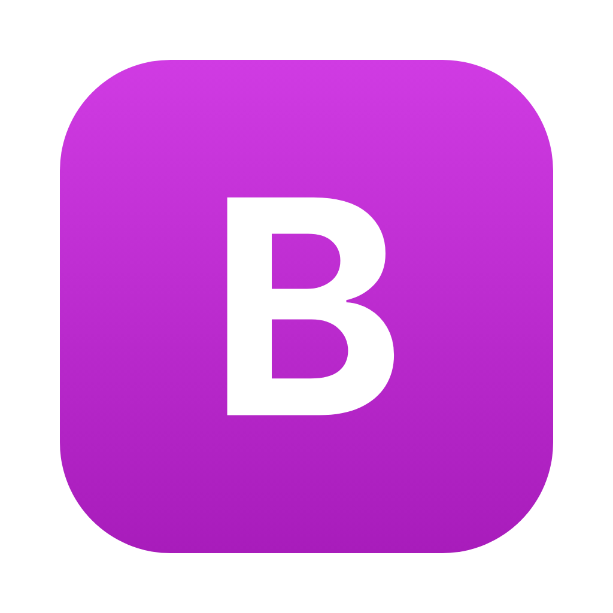

<p align="center">
  
</p>

<h1 align="center">BetterCodex</h1>

<p align="center">A Codex desktop app for macOS and Linux whose browser lives on the machine your threads run on.</p>

Work with Codex threads on your laptop or on any machine you reach over SSH. Each machine keeps its own browser, so
the sign-ins and open tabs Codex uses are the ones on that machine, and every window you open shows the same tabs.
Codex can read and drive those tabs freely, and you can click and type in them right next to the chat.

Pages always render on the computer you are sitting at, so they feel like any other browser. A tab that lives on
another machine shows up as a synced copy: what you click and type in it happens on that machine too, and what Codex
does there shows up in your copy a moment later. Forms are sent once, from the machine that owns the tab.

Schedule work the way Codex does, on any of your machines: a daily job that starts a fresh thread, a recurring
check-in, or a message that comes back to a thread at a set time. Tasks run on the machine they belong to, even while
the app is closed, and Codex can list, create and change them on its own, on your other machines too.

No ChatGPT account screens and no usage dashboards: threads, models, reasoning levels, approvals, the browser and
scheduled tasks.

## Download

Get the latest build from [Releases](https://github.com/gregor-tokarev/bettercodex/releases/latest): the `.dmg` for
Apple silicon Macs, the `.AppImage` or `.deb` for Linux. You need the [Codex CLI](https://github.com/openai/codex)
installed and signed in.

The Mac app isn't notarized yet. After moving it to Applications, run this once so macOS lets it open:

```sh
xattr -dr com.apple.quarantine /Applications/BetterCodex.app
```

You only do this once. When a new build is out, an update button shows up at the bottom of the sidebar; one click
installs it and restarts the app. The `.AppImage` updates the same way, while the `.deb` sends you to the download page.

## Build from source

Install Node.js 20+ and the [Codex CLI](https://github.com/openai/codex). Machines you add over SSH need Node.js 20+
and the Codex CLI too.

```sh
git clone https://github.com/gregor-tokarev/bettercodex.git
cd bettercodex
npm install
npm start
```

`npm run dist:mac` and `npm run dist:linux` build installable apps.

## License

[MIT](LICENSE)
